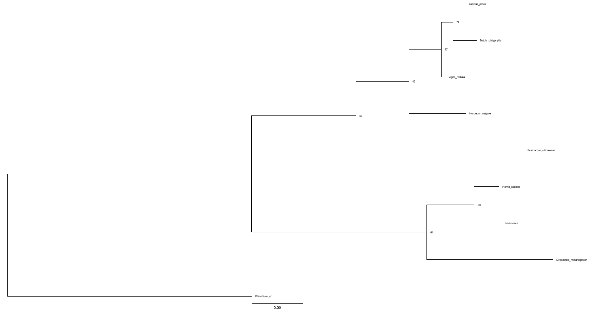

# Inferencias Evolutivas - Respuestas

Tomás Neira Guitera

Secuencias usadas: [SecuenciasCytocromoC.fasta](https://raw.githubusercontent.com/AJVelezRueda/Introduccion_a_la_Bioinformatica/master/Teorico_Practicos/Inferencias_evolutivas/SecuenciasCytocromoC.fasta) (9 secuencias, incluida la de bartmosca).

> Aclaración: el enunciado habla de *Cyt P450*, pero todas las secuencias del archivo (y la de bartmosca) son de **citocromo c**, así que trabajé pensando en esa proteína.


## Desafío I

**Detalla las tácticas y/o metodologías que deberían utilizarse para darles una respuesta a los padres del niño. Dadas las secuencias de Mosca, humano y Moscahumano ¿Qué criterios se les ocurren para comparar las secuencias? ¿Qué resultados obtienen del análisis anterior? ¿Qué resultado esperaría obtener si utilizara el resto de las secuencias en el análisis? ¿Por qué?**

### Metodología

Para responderles a los padres con datos y no con lo que dice la tele, lo que haría es:

1. Tomar la secuencia del niño y las secuencias ortólogas (mismo gen) de humano y de mosca (*Drosophila melanogaster*).
2. Alinearlas, porque sin un alineamiento no sé qué posición de una secuencia corresponde con cuál de la otra.
3. Con el alineamiento, comparar las secuencias de a pares y ver a cuál se parece más la del niño.
4. Después sumar más especies y armar un árbol filogenético, para ver en qué lugar queda el niño respecto al resto.

### Criterios para comparar

- **Porcentaje de identidad**: cuántas posiciones tienen exactamente el mismo aminoácido (contando solo las posiciones donde ninguna de las dos secuencias tiene gap).
- **Distancia evolutiva**: la proporción de sitios distintos (p-distancia = 1 − identidad), que se puede corregir porque en secuencias muy lejanas un mismo sitio pudo cambiar varias veces.
- **Similitud química**: no es lo mismo cambiar un aminoácido por otro parecido (por ejemplo I por V) que por uno muy distinto.
- **Regiones conservadas**: fijarse si los motivos importantes de la proteína están en todas. En el citocromo c está el motivo **CXXCH** que une el grupo hemo (en el alineamiento aparece como `CSQCH` en humano y `CAQCH` en mosca y bartmosca).
- **Dónde están las diferencias**: si están repartidas por toda la secuencia o concentradas en una zona.

### Resultados

Alineé las tres secuencias con Clustal Omega (ver Desafío II) y calculé la identidad de a pares:

| Par | Posiciones iguales / comparadas | % identidad |
|---|---|---|
| bartmosca – humano | 97 / 105 | **92,4 %** |
| bartmosca – mosca | 80 / 106 | 75,5 % |
| humano – mosca | 80 / 104 | 76,9 % |

La secuencia del niño se parece **mucho más a la humana** que a la de la mosca. De hecho bartmosca se parece a la mosca más o menos lo mismo que un humano normal se parece a la mosca (75,5 % vs 76,9 %), o sea que no tiene nada especialmente "de mosca".

Mirando el alineamiento, desde la región `GGKHKTG...` hasta el final bartmosca es **idéntica** al humano. Todas las diferencias están al principio (extremo N-terminal): tiene un par de aminoácidos de más y algunos cambios, y ahí sí coincide con la mosca en unas pocas posiciones (por ejemplo `IFVQ` en vez de `IFIM` del humano). Pero son poquitos residuos en una zona que es la más variable de la proteína.

### ¿Qué esperaría con el resto de las secuencias?

Esperaría que bartmosca siga quedando junto al humano, y que el árbol muestre los grupos esperables: los animales (humano, bartmosca, mosca) por un lado, las plantas (cebada, altramuz, abedul, vigna) por otro, el alga parda (*Ectocarpus*) cerca de las plantas y la bacteria (*Rhizobium*) bien separada de todo. Agregar especies lejanas no cambia lo parecidas que son bartmosca y humano, pero sí da contexto: permite ver que el 92 % de identidad entre ellas es muchísimo comparado con, por ejemplo, humano vs plantas. Además la bacteria sirve como **grupo externo** para enraizar el árbol.

Igual hay que tener en cuenta que el citocromo c es una proteína muy conservada y corta (~105 aminoácidos), así que sirve para separar grupos grandes, pero con un solo gen no alcanza para afirmar algo tan fuerte como que el niño es mitad mosca.


## Desafío II

**Confecciona el alineamiento para el punto I.**

Usé **Clustal Omega 1.2.4** con los parámetros por defecto para proteínas. Hice dos alineamientos:

- Las 3 secuencias del punto I: [`alineamiento_3secuencias.aln-clustal_num`](inferencias_evolutivas/alineamiento_3secuencias.aln-clustal_num)
- Las 9 secuencias del archivo (para el árbol del desafío III): [`alineamiento_9secuencias.aln-clustal_num`](inferencias_evolutivas/alineamiento_9secuencias.aln-clustal_num)

Alineamiento de las 3 secuencias:

```
CLUSTAL O(1.2.4) multiple sequence alignment

Homo_sapiens        ----MGDVEKGKKIFIMKCSQCHTVEKGGKHKTGPNLHGLFGRKTGQAPGYSYTAANKNK	56
Drosophila          MGVPAGDVEKGKKLFVQRCAQCHTVEAGGKHKVGPNLHGLIGRKTGQAAGFAYTDANKAK	60
bartmosca           --MGSGDAENGKKIFVQKCAQCHTYEVGGKHKTGPNLHGLFGRKTGQAPGYSYTAANKNK	58
                          **.*:***:*: :*:**** * *****.*******:******* *::** *** *

Homo_sapiens        GIIWGEDTLMEYLENPKKYIPGTKMIFVGIKKKEERADLIAYLKKATNE	105
Drosophila          GITWNEDTLFEYLENPKKYIPGTKMIFAGLKKPNERGDLIAYLKSATK-	108
bartmosca           GIIWGEDTLMEYLENPKKYIPGTKMIFVGIKKKEERADLIAYLKKATNE	107
                    ** *.****:*****************.*:** :**.*******.**:
```
(acorté los nombres para que entre en la página; en el archivo están los encabezados completos)

Lo que se ve es que casi todos los gaps están en el principio de las secuencias y que la parte central y final está muy conservada en las tres (muchos `*`). La segunda mitad de bartmosca es exactamente igual a la humana.


## Desafío III

**Mediante el uso de IQ-TREE confecciona los árboles filogenéticos para los alineamientos obtenidos en el punto II.**

Usé **IQ-TREE 2** con el alineamiento de las 9 secuencias, dejando que el programa eligiera el modelo de sustitución (ModelFinder) y con 1000 réplicas de **ultrafast bootstrap**. Como grupo externo puse a *Rhizobium* (la bacteria). Con solo las 3 secuencias no tiene sentido hacer el árbol: con 3 especies hay una sola topología posible sin raíz y no se puede calcular bootstrap.

Archivos: [`arbol.treefile`](inferencias_evolutivas/arbol.treefile) (árbol de máxima verosimilitud), [`arbol.contree`](inferencias_evolutivas/arbol.contree) (con los valores de bootstrap) y [`arbol.iqtree`](inferencias_evolutivas/arbol.iqtree) (reporte completo).



### ¿A qué se refiere el modelo de sustitución?

Es el modelo que usa el programa para estimar **cómo y con qué probabilidad cambia un aminoácido por otro** a lo largo del tiempo. No todos los cambios son igual de probables (cambiar entre aminoácidos parecidos pasa más seguido que entre aminoácidos muy distintos) y además algunos sitios de la proteína evolucionan más rápido que otros. El modelo tiene en cuenta todo eso para calcular mejor las distancias y las longitudes de las ramas, y también para corregir que un sitio pudo haber cambiado más de una vez.

En mi caso ModelFinder eligió **Dayhoff+G4**: Dayhoff es una matriz de sustitución de aminoácidos y el "+G4" agrega una distribución gamma con 4 categorías para modelar que hay sitios rápidos y sitios lentos (en el citocromo c tiene sentido porque hay zonas re conservadas, como la que une el hemo, y otras más variables como el N-terminal).

### ¿Qué es el Bootstrap? ¿Cómo nos habla de la calidad del árbol? ¿Cómo influye el número de réplicas?

El bootstrap es un método estadístico de remuestreo: se arman muchos alineamientos "falsos" eligiendo columnas del alineamiento original al azar (con reposición), se hace un árbol con cada uno y después se cuenta **en qué porcentaje de esos árboles aparece cada rama**. Ese porcentaje es el valor que aparece en cada nodo.

- Si un nodo tiene un valor alto, quiere decir que ese agrupamiento se sostiene aunque cambiemos un poco los datos, entonces es confiable. Para el bootstrap clásico se suele tomar ≥70 % como buen soporte, y para el ultrafast bootstrap de IQ-TREE recomiendan ≥95 %.
- Si el valor es bajo, ese nodo puede cambiar fácilmente y no conviene sacar conclusiones de él.

Con respecto al número de réplicas: con pocas réplicas (por ejemplo 10) los valores son muy inestables, porque un solo árbol cambia el porcentaje en un 10 %. Con más réplicas (1000) la estimación es más precisa y estable. Más réplicas no hacen que el árbol "sea mejor", sino que el valor de soporte que calculamos sea más confiable. El costo es que tarda más.

### Interpretación de los resultados

- **bartmosca queda agrupada con el humano** (soporte 70) y ese par queda con la mosca formando el grupo de los animales (soporte 84). O sea, la secuencia del niño es la de un humano, no la de una mosca.
- Las ramas de bartmosca (0,050) y humano (0,044) son cortitas y casi iguales; la de la mosca es unas 4-5 veces más larga (0,226). Eso indica que bartmosca acumuló muy pocos cambios respecto al humano.
- Las plantas quedan juntas, con la cebada (monocotiledónea) separada de las dicotiledóneas (altramuz, abedul y vigna). *Ectocarpus* queda cerca de las plantas.
- Los valores de soporte no son muy altos en general (ninguno llega a 95), y los nodos más profundos son los más flojos (43 para la cebada con las dicotiledóneas, 57 para *Ectocarpus* con las plantas). Tiene sentido porque el alineamiento tiene solo 44 sitios informativos: el citocromo c es corto y muy conservado, entonces no tiene suficiente información para resolver bien todas las relaciones.

**Conclusión para los padres:** según este gen, el niño es humano. Las pocas diferencias están todas en el extremo inicial de la proteína, que es la región más variable, y no alcanzan para decir que tiene algo de mosca.

### ¿Es necesario algún paso extra antes de interpretar el árbol?

Sí, **enraizar el árbol**. IQ-TREE (y la mayoría de los métodos) genera árboles **no enraizados**: muestran qué secuencias están más cerca entre sí, pero no la dirección del tiempo, o sea no se sabe cuál es el ancestro común. Para poder leerlo como "de la raíz a las hojas" hay que elegir un **grupo externo** (outgroup), una secuencia que sabemos que está más alejada que todas las demás. En este caso usé la bacteria *Rhizobium*, y al enraizar por esa rama el resto del árbol queda ordenado correctamente. En FigTree esto se hace seleccionando la rama del outgroup y usando la opción *Reroot*. También conviene mostrar los valores de bootstrap en los nodos (*Node Labels*) para poder ver qué tan confiable es cada agrupamiento.


## Herramientas

- Clustal Omega 1.2.4 (Sievers et al. 2011)
- IQ-TREE 2 con ModelFinder y UFBoot (Kalyaanamoorthy et al. 2017; Trifinopoulos et al. 2016)
- FigTree para visualizar el árbol
